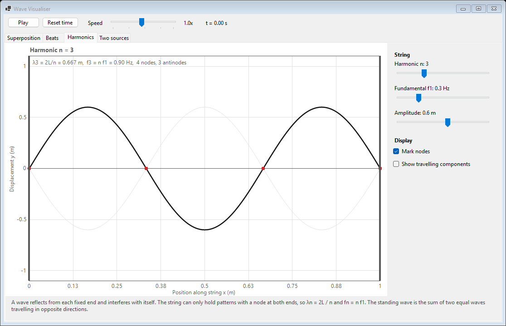

# Wave Visualiser

A small C# Windows Forms app that animates three bits of wave physics: two waves adding together, beats, and a standing wave on a string. Kept simple on purpose, it's just sine waves added up and drawn.



## Modes

| Mode | What you see | What it tells you |
|---|---|---|
| **Superposition** | Two travelling waves (blue and green) and their sum (red). Change the amplitude, wavelength, frequency and phase of each. | Phase difference, whether it's constructive or destructive, and the resultant amplitude from A² = A1² + A2² + 2·A1·A2·cos φ |
| **Beats** | Two waves with slightly different frequencies, plotted against time, with the beat envelope dashed over the top. | Beat frequency = \|f1 − f2\| and the beat period |
| **Standing wave** | A string fixed at both ends in its n-th harmonic, made from two identical waves going opposite ways. Nodes are marked. | Wavelength = 2L / n, number of nodes and antinodes |

Boxes that don't do anything in the current mode are greyed out. "Show both waves" hides the blue and green waves so you only see the result.

## Running it

Needs Windows and the [.NET 8 SDK](https://dotnet.microsoft.com/download/dotnet/8.0).

```
dotnet run --project WaveVisualiser -c Release
```

Or open `WaveVisualiser.sln` in Visual Studio and press F5. `Space` pauses, `R` resets the time.

## How it works

Each wave is worked out at 400 points across the screen and drawn as one line, about 30 times a second, on a double-buffered control so it doesn't flicker. That's all the drawing there is, so it runs smoothly even on a slow laptop.

- Travelling wave: y = A sin(2π(x/λ − f t) + φ)
- Beats: the same but x is time, and the envelope is √(A1² + A2² + 2·A1·A2·cos(2π(f1 − f2)t))
- Standing wave: two half-amplitude waves with λ = 2L / n going in opposite directions, added together

## Files

```
WaveVisualiser/
  WavePanel.cs    works out the waves and draws them
  MainForm.cs     the window: mode buttons, number boxes, speed, readout
  Program.cs      starts the app
```
