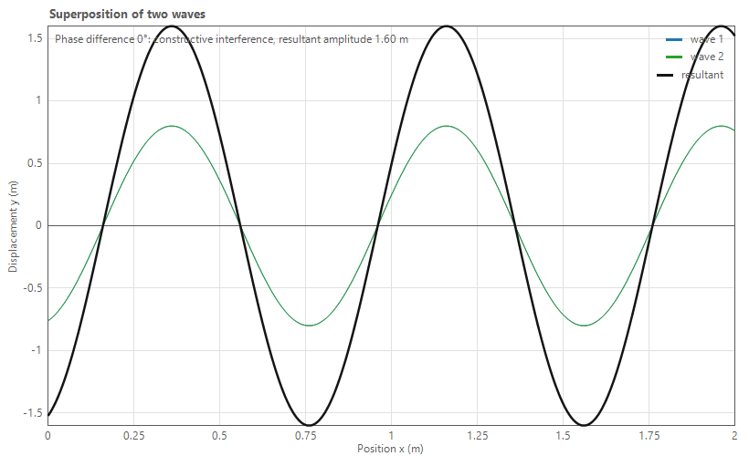
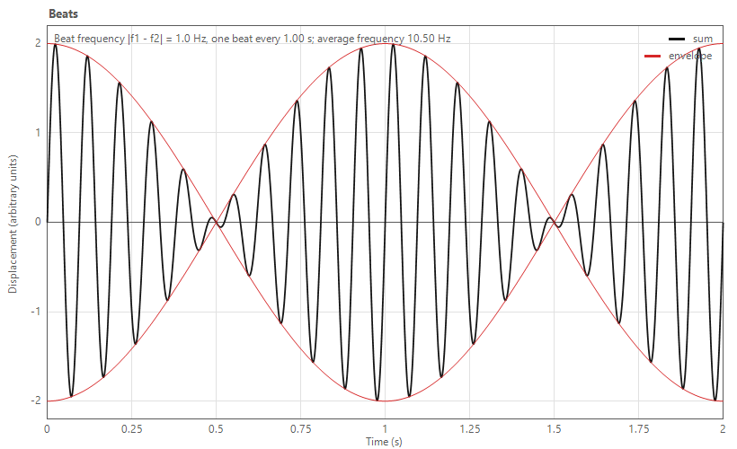
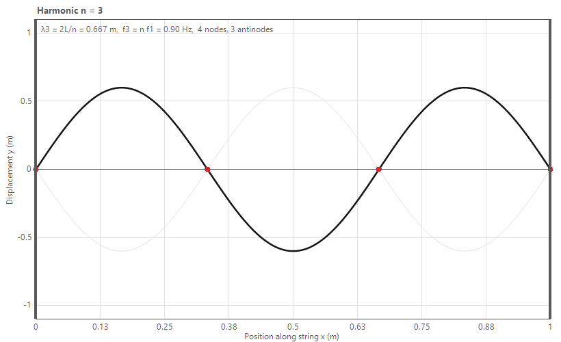
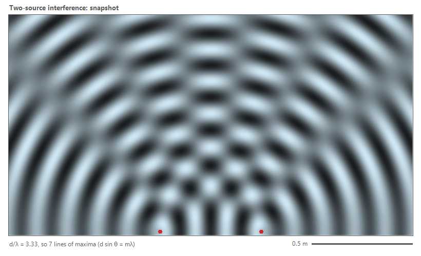

# Wave Visualiser

A small Windows desktop app that animates four pieces of A-Level wave physics: superposition of two waves, beats, standing-wave harmonics on a string, and two-source interference. Written in C# with Windows Forms, no external libraries.

A personal project to revisit the wave topics from A-Level Physics by coding them up rather than reading about them. The scenes are deliberately kept at that level: nothing beyond sine waves, superposition and path difference.


## What it does

Each tab is an animated plot with a few sliders and a one-line readout of the quantity the scene is about.

| Tab | Shows | Readout |
|---|---|---|
| **Superposition** | Two travelling waves and their sum. Change amplitude, wavelength, frequency and phase of each; send wave 2 the other way to form a standing wave. | Phase difference, constructive / destructive / partial, resultant amplitude from A² = A1² + A2² + 2A1A2 cos φ |
| **Beats** | Two tones of nearby frequency added together, with the slow envelope drawn over the top. | Beat frequency \|f1 − f2\|, beat period, average frequency |
| **Harmonics** | A string fixed at both ends vibrating in its n-th harmonic, with nodes marked. Optionally shows the two travelling waves whose sum is the standing wave. | λn = 2L / n, fn = n f1, number of nodes and antinodes |
| **Two sources** | A ripple-tank view of two in-phase point sources, as a moving snapshot or the time-averaged intensity pattern. | d / λ and the number of lines of maxima from d sin θ = mλ |

A toolbar pauses the animation, resets time and sets the playback speed. `Space` pauses, `R` resets.

| Superposition | Beats |
|---|---|
|  |  |

| Harmonics | Two-source interference |
|---|---|
|  |  |

## Software

- C# 12 on .NET 8 (Windows Forms), no NuGet packages
- Plots are drawn with GDI+ on a double-buffered control; the ripple tank writes pixels directly into a bitmap

## How to run

Install the [.NET 8 SDK](https://dotnet.microsoft.com/download/dotnet/8.0), then:

```bash
git clone https://github.com/siamct/wave-visualiser.git
cd wave-visualiser
dotnet run --project WaveVisualiser -c Release
```

Or open `WaveVisualiser.sln` in Visual Studio and press F5.

To regenerate the images in `docs/` without opening the window:

```bash
WaveVisualiser.exe --export docs
```

## How the physics is coded

- **Superposition:** y = A1 sin(2π(x/λ1 − f1 t)) + A2 sin(2π(x/λ2 ∓ f2 t) + φ), evaluated per pixel column.
- **Beats:** sin(2π f1 t) + sin(2π f2 t). The envelope is 2 cos(π (f1 − f2) t), from the sum-to-product identity.
- **Harmonics:** y = A sin(nπx/L) cos(2π n f1 t). The optional components are ½A sin(kx − ωt) and ½A sin(kx + ωt), which add to the same thing.
- **Two sources:** for each pixel, r1 and r2 are the distances to the sources. The snapshot is sin(k r1 − ωt) + sin(k r2 − ωt); the time-averaged intensity is cos²(k (r1 − r2) / 2).

## Project structure

```
WaveVisualiser/
  Modes/      One tab per scene (SuperpositionTab, BeatsTab, HarmonicsTab, TwoSourceTab)
  UI/         PlotPanel, axis and curve drawing, LabeledSlider, MainForm, ImageExport
docs/         Images used in this README
```

## What I learned

- **The identities are the picture.** Writing the envelope of beats and the travelling components of a standing wave as code made the sum-to-product identities concrete in a way the textbook derivation did not.
- **Sampling matters.** Plotting a 30 Hz tone over 4 seconds with one sample per pixel aliased badly. Curves that change quickly are sampled several times per pixel.
- **Per-pixel work has to be cheap.** The ripple tank computes one value per 2x2 block and writes straight into a locked bitmap. Calling `SetPixel` for every pixel was too slow to animate.
- **Keep the animation clock separate from the frame rate.** Time advances by real elapsed time multiplied by the speed setting, so the waves move at the same rate whatever the machine is doing.

## Licence

MIT. See [LICENSE](LICENSE).
